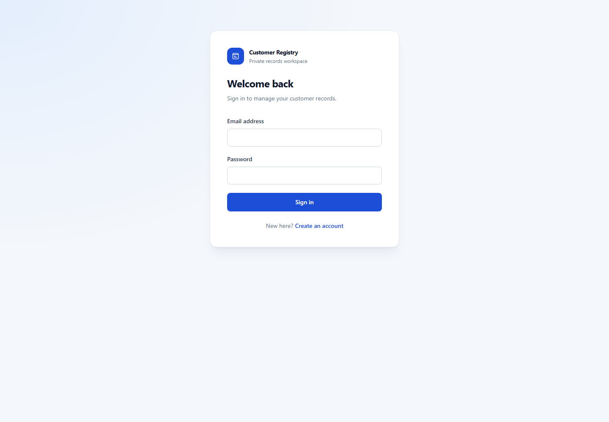

# Customer Registry Web

Customer Registry is a small Vue 3 and TypeScript app for keeping customer contact records. I built it as a full-stack portfolio project: the browser handles the interface and form feedback, while a separate API handles authentication, validation, and persistence.



## What it does

- Create an account and manage a private customer list.
- Add, search, edit, and remove customer records.
- Validate names, dates, phone numbers, email addresses, and account-number format.
- Mask account numbers in the list view.

## Frontend structure

```text
src/
  components/       Sign-in, customer list, form fields
  domain/           Customer model and repository
  services/         Authentication and HTTP clients
  utils/            Client-side validation
tests/              Vue unit tests
screenshots/        README preview
```

The components manage presentation and user input. `CustomerRepository` owns the in-memory list and coordinates CRUD operations. `RestApiService` handles customer HTTP requests; `AuthService` handles the short-lived session token. The API performs its own validation and authorization, so browser checks are there for quick feedback, not as a security boundary.

The backend is the separate `customer-registry-api` repository. Keeping it separate allows independent releases and keeps database credentials out of the browser project.

## Run locally

Use Node.js 20 and npm.

```sh
npm ci
cp .env.example .env
npm run serve
```

Set `VUE_APP_API_BASE_URL` in `.env` to the API address, normally `http://localhost:4000/api`. This is only a public API address. Vue CLI embeds variables prefixed with `VUE_APP_` in the downloaded JavaScript, so do not put a private key, JWT secret, or database URL there. The root `.env` is ignored by Git.

Useful commands:

```sh
npm run lint
npm run build
npm run test:unit
```

## Deploy

The intended demo setup is Netlify for this site, Render for the Express API, and Neon for Postgres. The `netlify.toml` file sets the Vue build command and `dist` publish folder. In Netlify, set `VUE_APP_API_BASE_URL` to `https://<your-api>.onrender.com/api` and deploy again.

The API's own README has the backend steps. In short: create a Neon database, push the API source to a GitHub repository named `customer-registry-api`, deploy it as a Render web service, then set the API's allowed origin to your Netlify URL. Netlify's Vue CLI guide explains the build settings and the public nature of `VUE_APP_` variables: [Vue CLI on Netlify](https://docs.netlify.com/build/frameworks/framework-setup-guides/vue-cli/).

## Notes before sharing

This is a portfolio demo, not a system for real customer or financial information. Password reset and email verification are not implemented; the browser keeps its bearer token in session storage; account numbers are stored as ordinary database text and only masked in the list UI. Use fictional records. Keep server secrets in the API's local `.env` or the API host's secret settings, and keep `.env` files out of Git.
