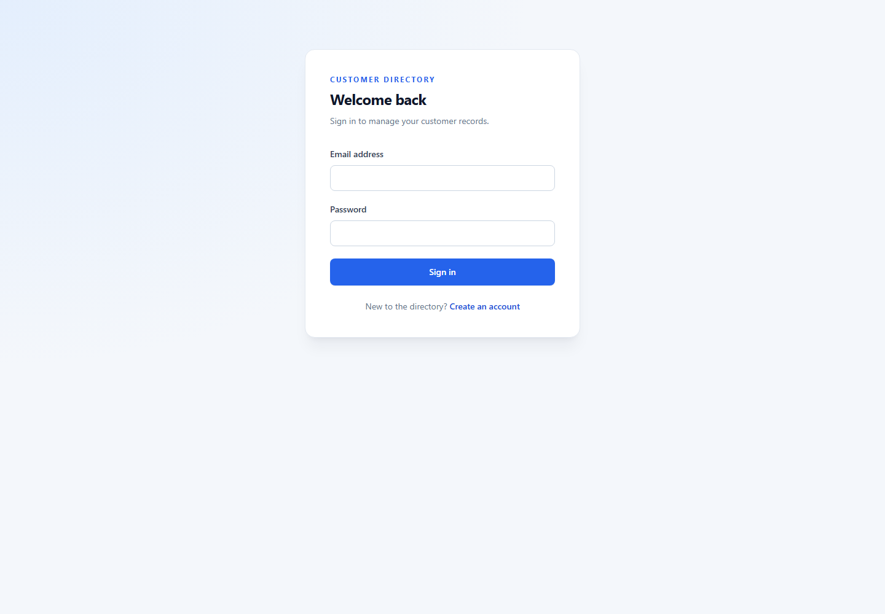

# Customer Directory

I built this project to practise a complete CRUD flow with Vue and TypeScript: forms, validation, API requests, and a small persistent data model. The frontend is a Vue 3 single-page app. Its authenticated API lives in the separate sibling folder `customer-directory-api`, so the browser app and server can be developed and deployed independently.

## Preview



## What it does

- Create an account, sign in, and manage a private set of customer records.
- Add, edit, and delete customers through a REST API.
- Validate contact details and reject duplicate email addresses or duplicate name-and-birth-date pairs.
- Keep records in Postgres rather than depending on browser storage.

## How it is put together

The UI is kept separate from the details of HTTP and persistence. Components collect input and show state; `CustomerRepository` coordinates customer operations; `RestApiService` sends the requests; and `AuthService` handles the sign-in session. The API validates requests again, hashes passwords, scopes every customer query to the signed-in user, and stores data in PostgreSQL.

```text
src/
  components/       Authentication, customer list, forms, shared controls
  domain/           Customer model and repository
  services/         Authentication and HTTP clients
  utils/            Frontend validation
tests/              Existing unit tests
screenshots/        README preview
```

The API source is in the sibling folder `../customer-directory-api`. It has its own dependencies, environment file, database schema, and deployment. Keeping it outside this repository makes the boundary clear and lets each side have its own GitHub repository and deployment settings.

## Run the frontend locally

Use Node.js 20 or 22.

```sh
npm ci
cp .env.example .env
npm run serve
```

Open `http://localhost:8080`. The frontend `.env` contains only `VUE_APP_API_BASE_URL`, which is the address of the API. It is not a credential. Vue CLI embeds variables prefixed with `VUE_APP_` in the browser bundle, so never put a secret or database URL in this file.

## Run the API locally

The API needs a PostgreSQL database. Create one locally or use a hosted development database, then open `../customer-directory-api` in a terminal:

```sh
npm ci
cp .env.example .env
npm run dev
```

Fill in `DATABASE_URL` and replace `JWT_SECRET` in the API's `.env`. Set `CORS_ORIGINS` to the local frontend address (`http://localhost:8080,http://127.0.0.1:8080`). The API listens on `http://localhost:4000`; the frontend `.env` should point to `http://localhost:4000/api`.

## Deploy it for a portfolio demo

The split I recommend is Netlify for this Vue site, Render for the Express API, and Neon for hosted Postgres. Netlify's Vue CLI settings are `npm run build` and `dist`. The Netlify site needs `VUE_APP_API_BASE_URL` set to the deployed API URL plus `/api`. That value is public because it is only an API address. Keep `DATABASE_URL` and `JWT_SECRET` in Render's environment settings, never in the frontend or Git.

The API folder is separate, so deploy it from its own GitHub repository. In Render, create a Node web service from that repository, use `npm ci` to build and `npm start` to run it, then set `DATABASE_URL`, `JWT_SECRET`, and `CORS_ORIGINS`. `CORS_ORIGINS` must contain the exact Netlify site origin once Netlify has assigned it. The API's `/healthz` endpoint can be used for a health check.

Free hosting is suitable for a showcase, with a couple of trade-offs: Render's free API sleeps after 15 minutes without requests, so the first visit after a quiet period can take around a minute. Neon free Postgres scales to zero when idle and has monthly resource limits. Check each provider's current limits before relying on it for anything important. Use made-up portfolio records only; this project is a demonstration, not a place to store real bank details or other sensitive customer data.

## Before sharing the source

The old CrudAPI key was exposed in the previous version of the project. Revoke it at the provider and do not reuse it. Removing a key from the current files does not erase it from earlier Git commits; if the repository is public, rewrite its Git history or publish a fresh repository without that history. Keep `.env` files out of Git and use `.env.example` as the safe template.

## Handy commands

```sh
npm run lint
npm run build
npm run test:unit
```

The API uses Express, PostgreSQL, `pg`, Zod, bcrypt, and JWT. Its own README explains the routes and the backend setup in more detail.
