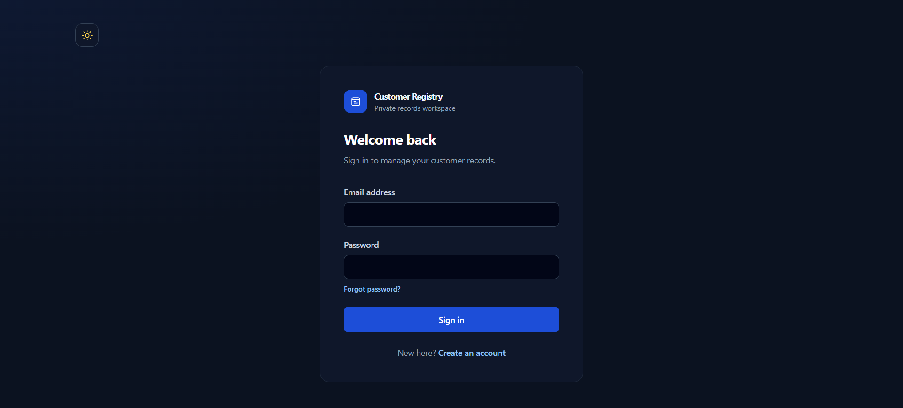
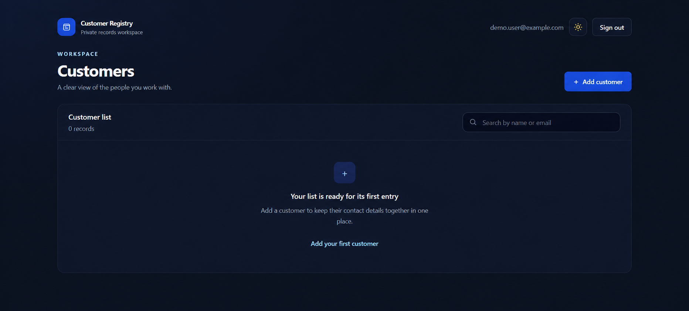
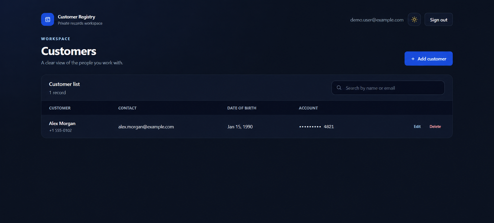
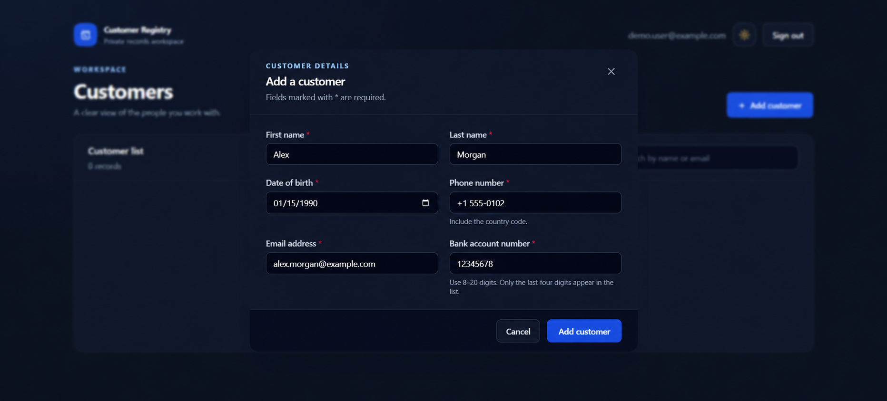

# Customer Registry

A small Vue 3 app for creating and managing private customer records. It uses Firebase Authentication for accounts and Firebase Realtime Database for each user's records.

**Live demo:** [customer-registery-mehdispace.netlify.app](https://customer-registery-mehdispace.netlify.app/)

## Preview

The screenshots use fictional demo values.

| Sign in | Empty customer list |
| --- | --- |
|  |  |

| Customer list | Add a customer |
| --- | --- |
|  |  |

## Features

- Register with email and password, sign in, and request a password reset email.
- Add, search, edit, and remove customer records.
- Switch between light and dark themes; the choice is saved in the browser.
- Validate contact details in the form and prevent duplicate records in the current user's list.
- Mask bank account numbers in the list view.
- Store each user's records under their Firebase Auth UID; database rules restrict reads and writes to that user.

## How the app is organized

```text
src/
  components/       Vue views and reusable form fields
  domain/
    entities/       Customer model
    repositories/   In-memory UI state and CRUD coordination
  services/         Firebase Auth, database operations, and app setup
  utils/            Client-side validation helpers
tests/              Component and validation tests
screenshots/        README preview
```

The components handle presentation and user input. `CustomerRepository` owns the current list state and applies duplicate checks. `CustomerDataService` maps customer operations to Realtime Database calls. `AuthService` wraps Firebase sign-in, registration, and password reset. Firebase rules provide the access boundary; browser validation is only for a faster form experience.

## Run locally

Use Node.js 20 or newer.

```sh
npm ci
```

Create a `.env` file in the project root using `.env.example` as a template. Fill it with the Firebase web app values from **Firebase Console → Project settings → Your apps**. The database URL is shown at the top of the Realtime Database **Data** page.

```sh
cp .env.example .env
npm run serve
```

On Windows PowerShell, copy the template with `Copy-Item .env.example .env`.

The Firebase web configuration is included in the built browser code, so its API key is a client identifier, not a private server credential. Do not put service-account keys, private keys, or administrator credentials in this app. Access to records is controlled by Firebase Authentication and Realtime Database rules.

## Firebase project setup

This app expects:

1. Firebase Authentication with the **Email/Password** provider enabled.
2. A Realtime Database in locked mode with these rules:

```json
{
  "rules": {
    "customers": {
      "$uid": {
        ".read": "auth != null && auth.uid === $uid",
        ".write": "auth != null && auth.uid === $uid"
      }
    }
  }
}
```

3. `localhost` and the deployed site domain listed in Authentication's **Authorized domains**.

Passwords are managed by Firebase Authentication and are never written to the database. The password reset control sends Firebase's standard reset email. If someone loses access to both their password and email account, recovery needs a trusted project administrator through Firebase Console; there is no admin password editor in the public app.

## Build and checks

```sh
npm run lint
npm run build
npm run test:unit
```

## Deploy the site

The existing `netlify.toml` configures the Vue CLI build and `dist` output. In Netlify, connect the GitHub repository and add the five `VUE_APP_FIREBASE_*` values from your local `.env` under **Site configuration → Environment variables**, then deploy. Add the Netlify site domain in Firebase Authentication's authorized domains. Firebase client config is public in the deployed JavaScript; database rules must remain scoped to the signed-in UID.

## Demo data

Use fictional information only. This is a portfolio example, not a system for real customer or financial records. Bank account values are stored as entered and only masked in the list display; this project does not encrypt them or implement regulated data controls.
